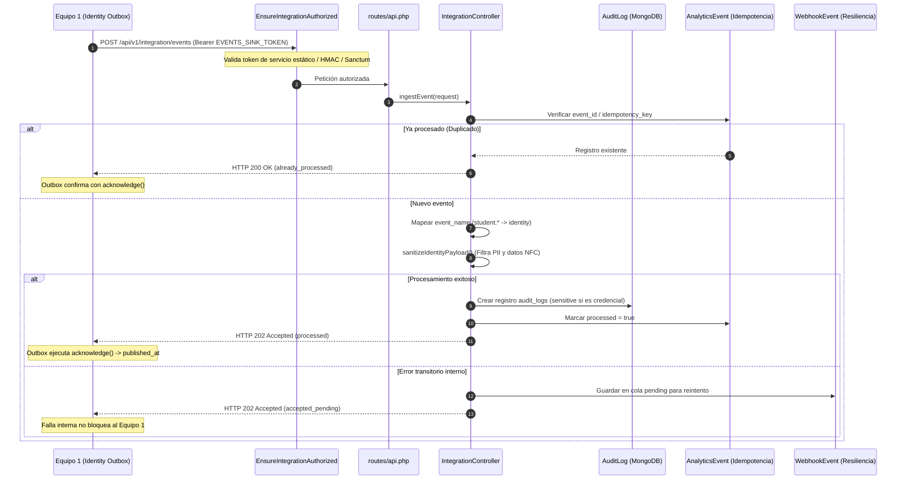

# Documentación Técnica de Cambios — Integración con Equipo 1 (Identidad y Acceso)

**Módulo:** Equipo 7 (Recompensas, Puntos, Gobernanza y Observabilidad)  
**Dominio integrado:** Equipo 1 (Identidad, Acceso, Credenciales NFC/QR y Perfil del Estudiante)  
**Fecha de implementación:** Noviembre 2026  
**Entorno:** Laravel 13 / PHP 8.3 / MongoDB 7 (Replica Set `rs0`)  

---

## 1. Contexto y Objetivos

El Equipo 1 es responsable de la identidad de los usuarios de Campus Digital. Su sistema registra cambios de estado de perfil, otorgamiento o revocación de consentimientos de privacidad y ciclo de vida de credenciales físicas (NFC) y digitales (QR).

El Equipo 1 solicitó integrar sus eventos con el receptor de auditoría transversal (7.8) y observabilidad (7.10) del Equipo 7. Tras inspeccionar su base de código en `Equipo 1/Proyecto_Grupal`, identificamos sus convenciones concretas de publicación vía Outbox (`PublishDomainEvents.php`) y realizamos adaptaciones en nuestro backend para garantizar compatibilidad nativa **sin que el Equipo 1 deba alterar su código existente**.

---

## 2. Arquitectura del Flujo de Integración



---

## 3. Detalle de Archivos Modificados

### 3.1 [`app/Http/Controllers/Api/IntegrationController.php`](file:///c:/Users/tecno/OneDrive/Desktop/7to_Semestre/Ingeniería%20de%20Software/Api/backend_respaldo/app/Http/Controllers/Api/IntegrationController.php)

#### Cambios principales:
1. **Validación flexible del sobre (`ingestEvent`)**:
   - Soporte simultáneo para `event_name` (formato del comando `events:publish` de E1) y `event_type` (formato canónico E7/E4).
   - Soporte para `aggregate_id` (que en E1 representa el `User._id` del estudiante o el `NfcCard._id`).
   - Resolución: `$eventType = $validated['event_type'] ?? $validated['event_name'];`.
2. **Mapeo automático de dominio**:
   - Los eventos que inician con `student.` (`student.profile.changed.v1`, `student.consent.changed.v1`) y `identity.` (`identity.credential.changed.v1`) se asignan forzosamente a `source_domain = 'identity'`, resolviendo la diferencia contractual planteada por E1.
3. **Idempotencia y detección de conflictos**:
   - Reintento con mismo `event_id`: Retorna `HTTP 200` (`status: already_processed`, `replayed: true`), permitiendo a su comando marcar el evento como publicado.
   - Conflicto (`event_id` duplicado con distinto `event_name`): Retorna `HTTP 200` y registra un evento de advertencia en `audit_logs` con `action = 'integration.event_id_conflict'`.
4. **Método `handleIdentityEvent()`**:
   - Clasifica los eventos de credencial (`identity.credential.changed.v1`) como eventos de alta sensibilidad (`sensitive: true`).
   - Mapea la acción a formato unificado de bitácora (`identity.student.profile.changed`, `identity.student.consent.changed`, `identity.credential.changed`).
   - Extrae el sujeto considerando `student_id`, `subject_id`, `user_id`, `credential_id` o `aggregate_id`.
5. **Método `sanitizeIdentityPayload()`**:
   - Remueve proactivamente campos PII: `email`, `phone`, `full_name`, `name`, `birth_date`, `address`, `password`, `token`, `secret`.
   - Para eventos de credencial, omite además: `nfc_uid`, `card_number`, `pin`, `otp`, `biometric_hash`.
6. **Resiliencia ante fallos**:
   - Si ocurre una excepción interna al persistir el log de auditoría, se encola en `webhook_events` (`status: pending`, `next_retry_at: now + 5 min`) y se responde `HTTP 202` (`accepted_pending`), asegurando que **una contingencia interna de E7 nunca provoque errores 5xx hacia el publicador de E1**.

---

### 3.2 [`app/Http/Middleware/EnsureIntegrationAuthorized.php`](file:///c:/Users/tecno/OneDrive/Desktop/7to_Semestre/Ingeniería%20de%20Software/Api/backend_respaldo/app/Http/Middleware/EnsureIntegrationAuthorized.php)

#### Cambios principales:
1. **Soporte de Autenticación Triple (Multi-mecanismo)**:
   - **Firma HMAC-SHA256**: Verifica cabeceras `X-Team-Signature` + `X-Team-Timestamp` contra el secreto del dominio indicado por `X-Team-Source-Domain`.
   - **Token Bearer de Servicio Estático (`EVENTS_SINK_TOKEN`)**: Si la petición envía `Authorization: Bearer <token>`, se valida directamente contra `config('services.team1.service_token')` o `config('services.team4.shared_secret')`.
   - **Token Bearer Sanctum**: En caso de peticiones emitidas por administradores o procesos internos autenticados vía Laravel Sanctum.

---

### 3.3 [`routes/api.php`](file:///c:/Users/tecno/OneDrive/Desktop/7to_Semestre/Ingeniería%20de%20Software/Api/backend_respaldo/routes/api.php)

#### Cambios principales:
- Se expuso la ruta canónica y los alias correspondientes para prevenir discrepancias de URL:
  - `POST /api/v1/integration/events` (Ruta especificada en `docs/integration/TEAM-7.md` de E1).
  - `POST /api/v1/integrations/ingest-event` (Ruta estándar del receptor unificado de E7).
  - `POST /api/v1/integrations/events` (Alias adicional).
- Todas protegidas bajo el middleware `integration.auth`.

---

### 3.4 [`config/services.php`](file:///c:/Users/tecno/OneDrive/Desktop/7to_Semestre/Ingeniería%20de%20Software/Api/backend_respaldo/config/services.php) y Variables de Entorno

#### Configuración agregada:
```php
'team1' => [
    'base_url'      => env('TEAM1_BASE_URL', 'http://localhost:8001'),
    'shared_secret' => env('TEAM1_SERVICE_SECRET', '<secreto acordado fuera de banda>'),
    'service_token' => env('TEAM1_SERVICE_TOKEN', env('TEAM1_SERVICE_SECRET', '<secreto acordado fuera de banda>')),
    'timeout'       => (int) env('TEAM1_TIMEOUT', 5),
],
```
En `.env` y `.env.example`:
```ini
TEAM1_BASE_URL=http://localhost:8001
TEAM1_SERVICE_SECRET=<secreto acordado fuera de banda>
TEAM1_SERVICE_TOKEN=<secreto acordado fuera de banda>
TEAM1_TIMEOUT=5
```

---

### 3.5 [`tests/Feature/Team1IntegrationApiTest.php`](file:///c:/Users/tecno/OneDrive/Desktop/7to_Semestre/Ingeniería%20de%20Software/Api/backend_respaldo/tests/Feature/Team1IntegrationApiTest.php)

Se implementó una suite con 7 casos de prueba automatizados:
1. `test_publish_domain_events_payload_con_event_name_y_bearer_token_es_aceptado`: Valida el sobre exacto de E1 con `event_name` y cabecera Bearer contra `/api/v1/integration/events`.
2. `test_student_consent_changed_v1_es_aceptado_y_auditado`: Valida eventos de consentimiento.
3. `test_identity_credential_changed_v1_es_aceptado_como_evento_sensible`: Comprueba que `sensitive = true` y que `nfc_uid` sea eliminado de `audit_logs`.
4. `test_evento_duplicado_retorna_200_already_processed_para_confirmar_outbox`: Comprueba el ACK idempotente.
5. `test_conflicto_de_event_id_retorna_200_y_audita_advertencia`: Comprueba la tolerancia a reintentos conflictivos.
6. `test_bearer_token_invalido_retorna_401`: Valida rechazo de tokens incorrectos.
7. `test_sin_event_name_ni_event_type_retorna_422`: Valida reglas de validación en caso de cuerpos vacíos.

---

## 4. Matriz de Compatibilidad E1 ↔ E7

| Requisito E1 | Cómo lo resuelve E7 | Estado |
|---|---|:---:|
| Conservar nombres `student.*` sin renombrar | Mapeo automático en receptor a `source_domain = identity` | ✅ |
| Envío de `event_name` en vez de `event_type` | Validación `required_without` dual en `IntegrationController` | ✅ |
| Preservar `aggregate_id` en el sobre | Campo admitido y mapeado a `entity_id` / `subject_id` | ✅ |
| Autenticación con `EVENTS_SINK_TOKEN` | Middleware verifica Bearer estático contra secreto de E1 | ✅ |
| Retorno HTTP 2xx para confirmar Outbox | Retorno `202` (nuevo) y `200` (duplicado) | ✅ |
| Falla del receptor no bloquea operación de identidad | Manejo con captura de excepciones y encolado en `webhook_events` | ✅ |
| Privacidad: No almacenar datos personales (PII) | Función de sanitización `sanitizeIdentityPayload()` | ✅ |
| Prevención de duplicación de auditoría | Una sola entrada generada por evento recibido | ✅ |

---

## 5. Verificación de Integridad

- **Verificación de sintaxis:** Todos los archivos PHP validados con `php -l` con **0 errores**.
- **Coexistencia con otros equipos:** La integración con el Equipo 4 (Inventarios / Almacenes) y Equipo 3 (Marketplace) permanece intacta e independiente mediante discriminación de dominios en middleware y controlador.

