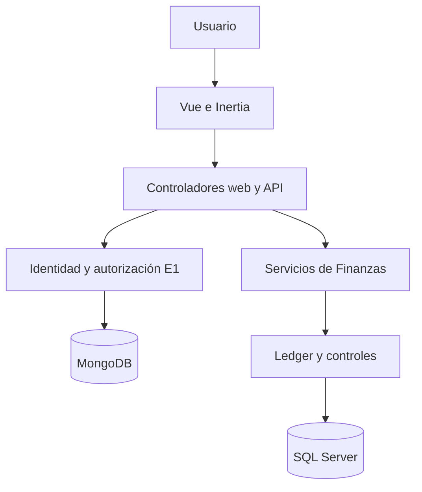

# Campus Virtual

Plataforma digital universitaria orientada al estudiante. El proyecto integra identidad digital, credenciales NFC/QR, perfiles académicos, autenticación segura y servicios compartidos para los demás módulos del ecosistema Campus Digital.

Campus Digital integra los dominios de los equipos participantes. Esta rama corresponde al **Equipo 2: Finanzas** y conserva la documentación de **Equipo 1: Identidad, Acceso, NFC/QR y Perfil del Estudiante** como referencia de integración.

- [Módulo 2 — Finanzas, wallet y operaciones](#módulo-2--finanzas-wallet-y-operaciones)
- [Alcance del Equipo 1](#alcance-del-equipo-1)

## Módulo 2 — Finanzas, wallet y operaciones

### Alcance y versiones

El Equipo 2 mantiene el dominio financiero de Campus Digital. Su responsabilidad es custodiar el saldo, registrar movimientos, procesar recargas, retiros, bonos, transferencias, devoluciones, caja y comprobantes, y aplicar controles financieros. Identidad (E1) proporciona la identidad autenticada y los permisos contextuales.

- Rama de desarrollo: `feat/modulo-2-equipo-2` en [Proyecto-Grupal-API/Proyecto_Grupal](https://github.com/Proyecto-Grupal-API/Proyecto_Grupal).
- Entrega de integración: Plan B, candidata `6710e59`, complemento E2 correcciones 1 y Wallet 2. Esta variante incluye los siete equipos y cambios locales posteriores a la candidata.
- Las características de Wallet 1 y Wallet 2 descritas aquí corresponden al paquete integrado. Su publicación en GitHub y en el servidor compartido requiere integrar y validar ese código.
- El paquete usa datos sintéticos de demostración; los importes no representan dinero real.

### Submódulos

| ID | Responsabilidad | Componentes principales |
|---|---|---|
| 2.1 | Cuentas wallet, saldo disponible y retenido, moneda, estado, propietario. | `WalletService`, `Wallet` |
| 2.2 | Libro contable, transacciones, movimientos y trazabilidad de saldos. | `LedgerService`, `LedgerEntry`, `FinancialTransaction` |
| 2.3 | Recargas, folio, método, estados y confirmación del abono. | `TopUpService`, `TopUpController` |
| 2.4 | Retiros, solicitudes y liquidación controlada; bloqueo de wallet en operaciones concurrentes. | `WithdrawalService`, `WithdrawalController` |
| 2.5 | Bonos restringidos, vigencia, consumo, becas, presupuestos, compromisos, obligaciones y liquidación institucional. | `BonusService`, `InstitutionalBudgetService`, `InstitutionalBecaIssuanceService`, `InstitutionalSettlementService` |
| 2.6 | Transferencias y regalos de saldo, identificación del destinatario, preparación, confirmación, historial y política compartida. | `StudentTransferService`, `StudentTransferConfirmationService`, `StudentTransferPolicyService` |
| 2.7 | Retenciones, liberaciones, capturas, devoluciones ordinarias y de compras, reversos autorizados. | `WalletHoldService`, `FinancialAdjustmentService`, `PurchaseRefundService` |
| 2.8 | Caja por asociación, turnos, movimientos, ajustes, aprobaciones y recuperación de efectivo. | `CashShiftService`, `CashSettlementService`, `CashSupervisorApprovalService` |
| 2.9 | Consulta personal y administrativa, folios existentes, evidencia histórica, impresión y descarga PDF. | `PersonalReceiptQueryService`, `CashReceiptService`, `ReceiptPdfService` |
| 2.10 | Límites monetarios y de conteo, alertas, conciliación, historial de políticas. | `FinancialLimitService`, `FinancialLimitGuard`, `TransactionAlertService`, `ReconciliationService` |

La tabla describe componentes presentes en el código integrado. La ejecución de cada flujo depende de los permisos, políticas, configuración e integración efectivamente habilitados.

### Arquitectura y persistencia

Laravel 13, PHP (la imagen Plan B usa PHP 8.5), Vue 3, Inertia, Vite, Tailwind y Composer/npm. MongoDB conserva identidad, perfiles y servicios de E1; SQL Server 2022 conserva el dominio financiero, mediante la conexión `sqlsrv` y los controladores PHP `sqlsrv`/`pdo_sqlsrv`. Los importes se representan como enteros en centavos; la interfaz los presenta en MXN cuando corresponde.



| Ubicación | Función |
|---|---|
| `app/Domains/Financial/Models` | Modelos de wallet, transacciones, bonos, caja, devoluciones y controles. |
| `app/Domains/Financial/Services` | Reglas de negocio, operaciones transaccionales y consultas. |
| `app/Domains/Financial/Contracts`, `Adapters` | Interfaces de integración y adaptadores de identidad/autorización. |
| `app/Http/Controllers/Financial` | Controladores HTTP, validación y respuestas. |
| `resources/js/Pages/Financial` | Vistas financieras Vue. |
| `routes/` | Rutas web y contratos API registrados por la variante. |
| `tests/Feature/Financial`, `tests/Unit`, `tests/Frontend` | Pruebas de dominio, contratos y comportamiento de interfaz. |

### Reglas y contratos de seguridad

- La wallet pertenece al titular identificado por el servidor. El acceso a comprobantes, movimientos y solicitudes usa la titularidad o permisos autorizados.
- El ledger registra débitos y créditos; una transferencia conserva las dos contrapartidas. Las operaciones financieras usan transacciones SQL y bloqueos cuando corresponde.
- Recargas y retiros conservan sus folios y estados. Las operaciones de efectivo se completan en el flujo de caja autorizado.
- Una retención separa fondos temporalmente indisponibles del saldo utilizable. La política de retenciones determina la vigencia por tipo de operación.
- Las devoluciones se solicitan y revisan antes de completar el movimiento. Las solicitudes pueden rechazarse; los reversos requieren autorización específica.
- Transferencias y regalos comparten los acumulados diarios y mensuales. La confirmación vuelve a validar saldo, identidad, permisos y política vigente.
- Los bonos tienen restricciones propias y no se convierten automáticamente en dinero de libre disposición.
- Los reintentos conservan la clave de idempotencia y los datos de la solicitud cuando el resultado previo es incierto.
- OAuth de servicio, scopes, sesión autenticada, autorización de dominio y segundo factor cuando esté configurado protegen las operaciones.
- Los comprobantes de caja emitidos tienen protección de inmutabilidad a nivel de modelo; la conciliación detecta diferencias y conserva evidencia sin corregir saldos automáticamente.

### API y navegación (referencia de Plan B)

La API financiera usa el prefijo `/api/v1/financial`. Las rutas siguientes ilustran los contratos; los parámetros y scopes exactos deben verificarse con `php artisan route:list --path=financial` en la versión ejecutada.

| Método | Ruta relativa | Uso |
|---|---|---|
| GET | `/wallets/{walletId}` | Consultar wallet. |
| GET | `/wallets/{walletId}/ledger` | Consultar movimientos. |
| POST | `/topups` | Solicitar recarga. |
| GET | `/topups/{topUpId}` | Consultar recarga. |
| POST | `/withdrawals` | Solicitar retiro. |
| GET | `/withdrawals/{withdrawalId}` | Consultar retiro. |
| GET | `/bonuses/{bonusId}` | Consultar bono. |
| POST / GET | `/refunds` / `/refunds/{refundId}` | Solicitar y consultar devolución. |
| POST | `/refunds/{refundId}/approve`, `/reject`, `/complete` | Gestionar una devolución con permiso correspondiente. |
| POST | `/holds` | Crear retención autorizada. |
| POST | `/holds/{holdId}/release`, `/capture` | Liberar o capturar. |
| POST | `/transactions/{transactionId}/reverse` | Reverso autorizado. |
| GET | `/limits`, `/alerts`, `/reconciliations` | Controles financieros. |

Familias adicionales: `student-transfers`, `cash/associations/{associationId}`, `marketplace`, `receipts`, servicios estudiantiles y pagos de eventos. La autenticación y el control de acceso son específicos de cada contrato.

| Pantalla web | Ruta |
|---|---|
| Mi cartera | `/finanzas` |
| Transferencias y regalos | `/finanzas/transferencias` |
| Bonos | `/finanzas/bonos` |
| Retenciones y devoluciones | `/finanzas/ajustes` |
| Caja | `/finanzas/caja` |
| Comprobantes | `/finanzas/comprobantes` |
| Controles | `/finanzas/controles` |

### Roles de demostración de Plan B

Los usuarios demo usan el sufijo `@campus.test` y la contraseña generada por el instalador correspondiente.

| Cuenta | Función |
|---|---|
| `demo.e2` | Operación de caja. |
| `demo.e2.presidencia` | Presidencia y delegación de caja. |
| `demo.e2.supervisor` | Supervisión y segunda autorización. |
| `demo.e2.alumno` | Wallet personal, recargas, retiros y envíos. |
| `demo.e2.alumno2` | Destinatario de transferencias y regalos. |
| `demo.e2.controles` | Administración de límites, alertas y conciliación (2FA). |
| `demo.e2.consulta` | Consulta de controles (2FA). |

Estos perfiles describen el propósito de demostración; los permisos efectivos dependen de la autorización del servidor.

### Integración con equipos

E1 proporciona identidad, directorio, autorización y sesión. E3 utiliza checkout y comprobantes de compra. E4 e inventarios dependen de los contratos del flujo comercial que corresponda. E5 consume operaciones financieras para servicios, multas y el piloto de garantías. E6 integra pagos de eventos y becas institucionales. E7 puede consumir los contratos de recompensas y beneficios acordados. La existencia de un contrato no acredita por sí sola la integración de extremo a extremo.

### Refactors y evidencia de cambios

| Commit | Cambio |
|---|---|
| `80d6dae` | Extrae el trait `RespondsWithCashOperations` para unificar validación, respuestas JSON y errores de `TopUpController` y `WithdrawalController`. Añade `CashOperationApiContractTest.php`. |
| `263e6f5` | Protege los comprobantes de caja emitidos. |
| `e3579e8` | Bloquea la wallet al solicitar y completar retiros. |
| `a7ab7bd` | Valida los pares de transferencias y referencias nulas en conciliación. |
| `c4e040c` | Conserva solicitudes y claves en reintentos financieros. |
| `ebaf6a2` | Añade botón para crear wallet personal en la rama E2. |

Los cuatro cambios de integridad comprendidos entre `263e6f5` y `c4e040c` se adaptaron a la candidata Plan B mediante el complemento de correcciones, junto con diagnóstico de matrícula y manejo de disponibilidad del directorio. La creación de wallet del commit `ebaf6a2` corresponde a la rama E2; esta entrega de Plan B conserva su flujo de cuentas preasignadas.

### Cambios específicos de Wallet 1 y Wallet 2

- Wallet 1: tarjeta con titular, ID abreviado y copiable, saldo disponible y retenido, moneda y estado; accesos rápidos, últimos 20 movimientos enlazados al comprobante cuando existe, solicitudes de devolución con filtros, fecha de actualización y motivo de rechazo.
- Wallet 2: diseño ampliado con degradados azul-violeta, distribución de botones, iconos, gráfica de egresos brutos de los últimos movimientos, acumulados diario/semanal/mensual de transferencias y regalos y tarjeta de cumpleaños en preparación, confirmación y detalle del regalo completado.
- El consumo semanal se calcula desde los movimientos; el tope semanal propio no está configurado en el modelo vigente. Los límites diarios y mensuales se calculan en servidor según la política.
- Los comprobantes conservan referencias y folios reales. La ausencia de evidencia histórica se identifica explícitamente.

### Ejecución

#### Paquete integrado Plan B Wallet 2

Con Docker Desktop iniciado y Ubuntu/WSL2, extrae la entrega en el sistema de archivos Linux y entra en `A_PAQUETE_CAMPUS`.

```bash
sha256sum -c SHA256SUMS
bash campus.sh instalar    # primera instalación
bash campus.sh iniciar     # siguientes sesiones
bash campus.sh estado
bash campus.sh detener
```

Acceso local: http://localhost:18080/finanzas. La primera preparación compila la interfaz con Node 22 y npm ci y requiere conexión a Internet. Para actualizar una instalación anterior, extrae en otra carpeta, conserva su configuración privada y el proyecto Compose para reutilizar los volúmenes, y detén la instancia anterior antes de iniciar la nueva. Consulta las guías del paquete.

#### Rama E2

La rama tiene su configuración propia de Docker local, documentada en `docs/modulo-2/docker-local.md`, con puerto de revisión 8082 y bases SQL Server y MongoDB externas. Sigue esa guía y el diagnóstico de instalación de la rama. No publiques archivos de entorno ni credenciales.

### Validación y pendientes

La prueba de reembolso aprobada se realizó en el entorno de demostración previo. Para las correcciones y Wallet 2 se revisaron los archivos de integración, la integridad del paquete, la sintaxis PHP y la compilación individual de vistas Vue. La compilación completa con Vite y las pruebas de extremo a extremo de Wallet 2 requieren validación en la instalación Docker. Las pruebas históricas no se presentan como una corrida nueva de la suite.

- Confirmar emisión y consumo de bonos con las autoridades y políticas definitivas.
- Verificar retenciones, reversos y devoluciones con perfiles autorizados en la versión realmente desplegada.
- Validar búsqueda por matrícula después de la auditoría del directorio, y confirmar el flujo de transferencia/regalo y la conciliación.
- Determinar si se requiere un tope semanal efectivo; hoy se muestra uso semanal sin tope propio configurado.
- Verificar comprobantes históricos y requisito QR de comprobantes.
- Conciliar `PENDIENTES-73.md` de la candidata con el despliegue y las evidencias vigentes; las observaciones históricas pueden estar desactualizadas.
- Integrar y validar el código de Wallet 2 en la rama y el servidor compartido.

---

## Alcance del Equipo 1

El equipo es responsable de construir la identidad común que consumen los demás módulos. Ningún dominio externo debe duplicar la lógica de autenticación ni la lectura de credenciales.

El alcance inicial contempla:

- Gestión de cuentas y perfil del estudiante.
- Autenticación, recuperación de contraseña y confirmación de cuenta.
- Autenticación de dos factores (2FA) desde la primera versión.
- Roles y permisos contextuales por negocio, asociación, Consejo o servicio.
- Registro y ciclo de vida de tarjetas NFC mediante UID simulado.
- Identidad QR y códigos temporales para validaciones.
- Dispositivos, sesiones confiables y alertas de acceso.
- Gestión y vinculación de dispositivos del usuario.
- Generación, escaneo y validación de códigos QR dinámicos para autenticación y asistencia.
- Validación de la condición estudiantil.
- Consentimientos y preferencias de comunicación.
- Servicios internos de identidad y credenciales para los demás equipos.

## Tecnologías

- **Backend:** Laravel 13 y PHP 8.3 o superior.
- **Frontend:** Vue 3, Inertia.js y Vite.
- **Autenticación:** Laravel Fortify y Breeze.
- **Estilos:** Tailwind CSS.
- **Pruebas:** Pest.
- **Persistencia:** MongoDB 7 para desarrollo local mediante Podman.
- **QR en frontend:** `qrcode` para renderizado y `@zxing/library` para escaneo con cámara.

La aplicación usa el paquete `mongodb/laravel-mongodb` y el modelo de usuario compatible con MongoDB. Laravel Fortify continúa siendo responsable de la autenticación; los módulos 1.8 y 1.9 solo consumen la identidad autenticada.

## Requisitos

- PHP 8.3 o superior.
- Composer.
- Node.js y npm.
- Git.
- Podman 5 o superior.
- Extensión PHP `mongodb`.

## Instalación

Clona el repositorio y entra en la carpeta del proyecto:

```bash
git clone https://github.com/Julian-Darkstar/campus-virtual.git
cd campus-virtual
```

Instala las dependencias de backend y frontend:

```bash
composer install
npm install
```

Las dependencias del módulo QR se incluyen en `package.json`: `qrcode` genera los códigos en el navegador y
`@zxing/library` lee códigos mediante la cámara. El backend reutiliza `mongodb/laravel-mongodb`; no es necesario
añadir otro paquete de Composer para generar imágenes porque el QR se renderiza en Vue.

Crea el archivo de entorno y genera la clave de la aplicación:

```bash
cp .env.example .env
php artisan key:generate
php artisan migrate
```

Si el proyecto ya estaba instalado, actualiza ambas dependencias antes de migrar:

```bash
composer install
npm install
php artisan migrate
```

Configura MongoDB en el archivo `.env`:

```env
DB_CONNECTION=mongodb
DB_HOST=127.0.0.1
DB_PORT=27017
DB_DATABASE=campus_virtual
DB_USERNAME=
DB_PASSWORD=
```

## MongoDB local con Podman

Descarga y ejecuta MongoDB 7 con un volumen persistente:

```bash
podman pull docker.io/library/mongo:7
podman run -d --name campus-mongo \
  -p 27017:27017 \
  -v mongo_data:/data/db \
  docker.io/library/mongo:7
podman update --restart=unless-stopped campus-mongo
```

Si el contenedor ya existe, solo inícialo:

```bash
podman start campus-mongo
```

Comprueba MongoDB y Laravel:

```bash
podman exec campus-mongo mongosh --quiet --eval "db.runCommand({ ping: 1 })"
php artisan config:clear
php artisan tinker --execute="DB::connection('mongodb')->command(['ping' => 1]); echo 'MONGO_OK';"
```

La instalación local de desarrollo no habilita autenticación en MongoDB. Para DataGrip utiliza `localhost`, puerto `27017`, autenticación `No authentication` y la base `campus_virtual`. En MongoDB, las tablas se representan como colecciones; la aplicación crea `users` y `sessions` cuando existen documentos.

## Ramas de desarrollo

Este proyecto utiliza un flujo de Git con dos ramas principales:

### `main`

- **Rama estable** que contiene versiones listas para producción.
- Cambios solo a través de pull requests revisados.
- Cada commit en `main` representa una versión funcional y documentada.

### `develop`

- **Rama de integración continua** donde se agrupan las features en construcción.
- Contiene trabajo en progreso, datos simulados y features pendientes de finalizar.
- Punto de referencia para ver el estado actual del desarrollo.
- Cambios se agrupan en commits temáticos antes de proponer PR a `main`.

### Flujo de trabajo

```
main (stable) ← ← ← ← develop (active development)
                    ↑
                  feature branches
```

1. Crea una rama de feature desde `develop`: `git checkout -b feature/nombre-feature`
2. Realiza cambios y commits
3. Cuando esté lista, integra a `develop` mediante PR
4. Cuando una versión esté completa, crea PR de `develop` a `main`

## Desarrollo local

Para iniciar la aplicación en el puerto `8002`:

```bash
php artisan serve --host=127.0.0.1 --port=8002
```

La aplicación estará disponible en <http://127.0.0.1:8002>.

En otra terminal, ejecuta Vite para recompilar los recursos durante el desarrollo:

```bash
npm run dev
```

## Módulos QR y dispositivos

Con una sesión autenticada están disponibles:

- `/security/qr`: genera un QR dinámico de un solo uso y permite escanear/validar otro QR con la cámara.
- `/security/devices`: vincula, consulta y desvincula dispositivos del usuario.
- `POST /api/v1/identity/qr/generate`: genera un token QR para clientes API autenticados con Sanctum.
- `POST /api/v1/identity/qr-validate`: valida un token, registra el resultado y consume los tokens dinámicos.

Las migraciones crean las colecciones MongoDB `devices`, `qr_tokens` y `qr_validations`, con índices para usuario,
token y expiración. La cámara requiere permisos del navegador y, en producción, un contexto HTTPS.

Para generar los recursos frontend de producción:

```bash
npm run build
```

## Pruebas

La suite de pruebas se ejecuta con:

```bash
php artisan test
```

También puede utilizarse el script de Composer:

```bash
composer test
```

Las pruebas usan la base MongoDB `campus_virtual_testing` y requieren el contenedor `campus-mongo` activo. El harness limpia esa base antes de cada prueba.

## OAuth 2.0 entre servicios

Los microservicios consumen la API interna mediante el grant estándar `client_credentials`. Esto es independiente del login web de Fortify.

Genera un cliente una sola vez y guarda el secreto fuera del repositorio:

```bash
php artisan oauth:client equipo-servicios --scope=students:read
```

Solicita un token:

```bash
curl -X POST http://127.0.0.1:8002/api/oauth/token \
  -d grant_type=client_credentials \
  -d client_id=svc_xxx \
  -d client_secret=xxx \
  -d scope=students:read
```

Usa el token como `Authorization: Bearer <access_token>` para las rutas `/api/v1`. Los tokens son JWT firmados, tienen issuer/audience, expiración y scopes. En producción define `OAUTH2_SIGNING_KEY` independiente de `APP_KEY` y rota los clientes periódicamente.

Los cambios de dominio implementan un contrato de eventos versionado (`*.v1`) y se guardan en la colección MongoDB `event_outbox` para que un publicador externo pueda entregarlos a otros servicios sin acoplarlos a las colecciones internas.

El publicador incluido se ejecuta con `php artisan events:publish`. Configura `EVENTS_SINK_URL` y, si el receptor lo requiere, `EVENTS_SINK_TOKEN`. Los eventos publicados reciben `published_at`; los fallidos conservan `attempts` y `last_error` para reintentos. En producción se recomienda ejecutarlo mediante scheduler o worker.

## Cambios Recientes

### Versión 0.2.0-dev (7 de septiembre de 2026)

#### Entrega actual del módulo 1
- **Módulo 1.1:** gestión académica en MongoDB con perfiles, catálogos, historial, CRUD e importación CSV.
- **Módulo 1.2:** autenticación de dos factores integrada con Fortify.
- **Módulo 1.3:** RBAC contextual con roles y scopes.
- **Módulos 1.4 y 1.5:** registro y ciclo de vida de credenciales NFC.
- **Módulos 1.6 y 1.7:** identidad QR, dispositivos, sesiones confiables y reautenticación.
- **Módulos 1.8 y 1.9:** interfaz y contrato API disponibles; la persistencia de condición, consentimientos y preferencias continúa pendiente.
- **Integración entre servicios:** OAuth 2.0 `client_credentials`, JWT, scopes y middleware Bearer.
- **Eventos de dominio:** eventos versionados, outbox MongoDB idempotente y comando `events:publish` con reintentos.
- **Calidad:** 29 pruebas correctas, 71 aserciones y build frontend exitoso.

#### Documentación
- La documentación formal del módulo 1 se encuentra en `/home/darkstar/IS/documentacion/terminada/modulo-1`.
- Incluye SRS IEEE 830, plan de desarrollo, arquitectura/API, plan de calidad, seguimiento y cierre.

### Versión 0.1.0-dev (28 de agosto de 2026)

#### Características Implementadas
- **Módulo 1.8**: Validación de condición estudiantil con estado, matrícula, programa y campus.
- **Módulo 1.9**: Gestión de consentimientos y preferencias de comunicación (email, push, SMS).
- **API REST v1**: Endpoints documentados bajo `/api/v1` con datos simulados:
  - Estado académico: GET `/students/{studentId}/status`
  - Historial: GET `/students/{studentId}/status/history`
  - Consentimientos: GET/POST/DELETE `/students/{studentId}/consents`
  - Preferencias: GET/PATCH `/students/{studentId}/preferences`
- **Identidad Visual**: Logo SVG, paleta de colores institucionales, rediseño de interfaz pública y autenticada.
- **Tipografía**: Fuente Manrope como identidad visual del proyecto.

#### Interfaz de Usuario
- Panel protegido en `/student-services` con módulos 1.8 y 1.9.
- Dashboard actualizado con acceso directo a nuevos módulos.
- Diseño responsivo con colores institucionales: azul marino (#00338D), gris pizarra (#64748B), verde validación (#10B981).

## Estado del proyecto

- [x] Estructura inicial Laravel.
- [x] Vue 3 + Inertia.js + Vite.
- [x] Autenticación base con Fortify y Breeze.
- [x] Módulo 1.1: perfiles académicos, catálogos, historial, CRUD e importación CSV adaptados a MongoDB.
- [x] Módulo 1.2: 2FA con Fortify.
- [x] Módulo 1.3: RBAC contextual.
- [x] Módulos 1.4 y 1.5: registro y ciclo de vida de credenciales NFC.
- [x] Módulos 1.6 y 1.7: identidad QR, dispositivos y sesiones confiables.
- [x] Migraciones iniciales de usuarios y 2FA.
- [x] Módulo 1.8: Validación de condición estudiantil (API + UI).
- [x] Módulo 1.9: Consentimientos y preferencias de comunicación (API + UI).
- [x] Identidad visual: Logo, colores institucionales, rediseño de pantallas.
- [x] Endpoints API REST v1 documentados y funcionales.
- [x] Pruebas automatizadas contra MongoDB: 29 pruebas correctas.
- [x] Integración de autenticación inter-servicios OAuth 2.0.
- [ ] Servicios y contratos de integración con los demás equipos.
- [x] Contratos de eventos versionados y outbox MongoDB.

### Notas de integración

- El módulo 1.1 se portó desde la rama SQL Server a documentos MongoDB (`campuses`, `academic_programs`, `student_profiles` y `academic_status_history`).
- La interfaz administrativa está disponible en `/students`; requiere un usuario con rol `admin` o `student_manager`.
- Los catálogos e índices de 1.1 se inicializan con `php artisan db:seed --class=StudentCatalogSeeder`.
- La importación CSV valida todas las filas antes de escribir. El contenedor local MongoDB usa el replica set `rs0`, habilitando transacciones multi-documento para atomicidad estricta.
- Los módulos 1.8 y 1.9 aún usan datos simulados y deben conectarse a `StudentProfile` y sus eventos cuando se cierre el contrato de dominio.
- La rama de entrega del equipo es `modulo-1`; `develop` conserva la integración continua y `main` permanece estable.

## Repositorio

Rama E2: <https://github.com/Proyecto-Grupal-API/Proyecto_Grupal/tree/feat/modulo-2-equipo-2>

Referencia original E1: <https://github.com/Julian-Darkstar/campus-virtual>

## Licencia

La licencia del proyecto se definirá por el equipo antes de la primera versión pública estable.
