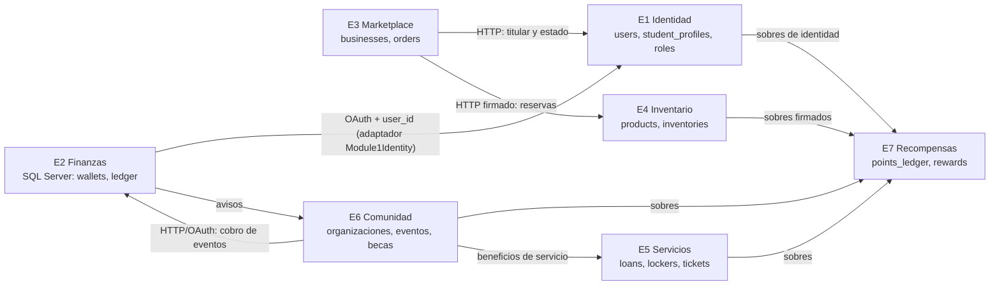

# Relaciones entre módulos y lecturas entre dominios (rúbrica 7.6)

| Campo | Valor |
|---|---|
| Versión | 1.0 |
| Fecha | 2026-11-13 |
| Responsables | Integración del tercer parcial (cierre E1–E7) |
| Método | Análisis estático de `use App\Models\…` por módulo propietario del archivo y del modelo (`scripts/refactor-css-e5/xdomain.py` en el paquete de cierre) |

## 1. Diagrama global de relaciones

Las flechas son contratos HTTP/sobres verificados en el laboratorio (09b, 9.x). Los identificadores canónicos son `users._id` (E1), `wallet public_id` (E2), `business_id` (E3/E4).

## 2. Lecturas directas de modelos de otro módulo (deuda 7.6)

| Lector → propietario | Archivos | Clasificación |
|---|---|---|
| E1 → E6 | 9 | Mayormente controladores de E6 en el espacio raíz `App\Http\Controllers` (clasificación ambigua por ubicación, no deuda de E1) |
| E6 → E1 | 24 | Lee `User`/`ServiceClient` directo (deuda menor; identidad compartida) |
| E3 → E1 | 1 | Comando de preparación (válido en mantenimiento) |
| E2 → E1 | 8 | Identidad compartida; parte pasa por `Module1IdentityAdapter` (válido), el resto lee `User` directo (deuda menor) |
| E5 → E1 | 2 | Lee `User/StudentProfile/Consent` directo (deuda) |
| E7 → E6 | 1 | Lee `AuditoriaComunidad` de E6 al entregar sobres (deuda) |
| E5 → E6 | 2 | Lee `AsignacionBeneficio` de E6 directo (deuda: debería ser contrato) |
| E7 → E1 | 1 | Autorización por roles E1 leída directo (deuda menor) |

## 3. Brechas concretas
1. E5 → E6 `AsignacionBeneficio`: exponer un contrato de lectura de beneficios en E6 y consumirlo desde E5.
2. E7 → E6 `AuditoriaComunidad`: registrar la entrega en un sobre/evento en vez de leer la colección.
3. Lecturas directas de `User`/`Role` fuera de E1: canalizarlas por los adaptadores de identidad ya existentes (como hace E2 con `Module1IdentityAdapter`).
4. Mover los controladores de E6 del espacio raíz a `App\Http\Controllers\Community` para que la propiedad sea explícita.

Estado en la rúbrica: 7.6 se mantiene «Cumple parcialmente» hasta cerrar 1–3; este documento aporta el diagrama global y el inventario que faltaban.

## 4. Detalle por par

### E1->E6
- `app/Console/Commands/DeliverServiceBenefits.php` usa `AsignacionBeneficio`
- `app/Console/Commands/ReconcileScholarshipBonuses.php` usa `AsignacionBeneficio`
- `app/Http/Controllers/ComunicacionController.php` usa `AuditoriaComunidad`
- `app/Http/Controllers/ComunicacionController.php` usa `Campana`
- `app/Http/Controllers/ComunicacionController.php` usa `ConvocatoriaBeca`
- `app/Http/Controllers/ComunicacionController.php` usa `Evento`
- `app/Http/Controllers/ComunicacionController.php` usa `Mensaje`
- `app/Http/Controllers/ConsultaController.php` usa `AuditoriaComunidad`
- `app/Http/Controllers/ConsultaController.php` usa `ConsultaComunidad`
- `app/Http/Controllers/Controller.php` usa `Organizacion`
- `app/Http/Controllers/DashboardController.php` usa `Campana`
- `app/Http/Controllers/DashboardController.php` usa `ConvocatoriaBeca`
- `app/Http/Controllers/DashboardController.php` usa `Eleccion`
- `app/Http/Controllers/DashboardController.php` usa `Encuesta`
- `app/Http/Controllers/DashboardController.php` usa `Evento`
- `app/Http/Controllers/DashboardController.php` usa `Mensaje`
- `app/Http/Controllers/DashboardController.php` usa `MiembroOrganizacion`
- `app/Http/Controllers/DashboardController.php` usa `RegistroEvento`
- `app/Http/Controllers/DashboardController.php` usa `ReporteTransparencia`
- `app/Http/Controllers/DashboardController.php` usa `RespuestaEncuesta`
- `app/Http/Controllers/DashboardController.php` usa `SolicitudBeca`
- `app/Http/Controllers/DashboardController.php` usa `Voto`
- `app/Http/Controllers/NotificacionController.php` usa `Mensaje`
- `app/Services/AudienciaCampana.php` usa `Campana`
- `app/Services/AudienciaCampana.php` usa `ConvocatoriaBeca`
- `app/Services/AudienciaCampana.php` usa `Evento`
- `app/Services/AudienciaCampana.php` usa `MiembroOrganizacion`
- `app/Services/AudienciaCampana.php` usa `PreferenciaComunicacion`
- `app/Services/AudienciaCampana.php` usa `RegistroEvento`
- `app/Services/AudienciaCampana.php` usa `SolicitudBeca`
- `app/Services/EntregaCampanas.php` usa `AuditoriaComunidad`
- `app/Services/EntregaCampanas.php` usa `Campana`
- `app/Services/EntregaCampanas.php` usa `Mensaje`
- `app/Services/EntregaCampanas.php` usa `Organizacion`

### E6->E1
- `app/Console/Commands/GestorOrganizaciones.php` usa `User`
- `app/Console/Commands/PrepareCommunityEventPayments.php` usa `ServiceClient`
- `app/Console/Commands/RecuperarPresidencia.php` usa `User`
- `app/Http/Controllers/BecaController.php` usa `User`
- `app/Http/Controllers/EventoController.php` usa `User`
- `app/Http/Controllers/GestionOrganizacionesController.php` usa `User`
- `app/Http/Controllers/OrganizacionController.php` usa `User`
- `app/Http/Controllers/StaffEventoController.php` usa `User`
- `app/Http/Middleware/AuthorizeCommunityService.php` usa `ServiceClient`
- `app/Policies/EventoPolicy.php` usa `User`
- `app/Policies/OrganizacionPolicy.php` usa `User`
- `app/Services/AutoridadOrganizaciones.php` usa `User`
- `app/Services/ComisionesConsejo.php` usa `User`
- `app/Services/ComiteBecas.php` usa `User`
- `app/Services/ConsultasComunidad.php` usa `User`
- `app/Services/CouncilBecaDesignationService.php` usa `RoleAssignment`
- `app/Services/CouncilBecaDesignationService.php` usa `User`
- `app/Services/CouncilBecaWebAuthorization.php` usa `SecurityEvent`
- `app/Services/CouncilBecaWebAuthorization.php` usa `User`
- `app/Services/DelegacionesComunidad.php` usa `User`
- `app/Services/DocumentosOrganizacion.php` usa `User`
- `app/Services/InscripcionesEvento.php` usa `User`
- `app/Services/PeriodosOrganizacion.php` usa `User`
- `app/Services/PermisosComunidad.php` usa `User`
- `app/Services/RegistroOrganizaciones.php` usa `User`
- `app/Services/ResponsabilidadesComunidad.php` usa `User`

### E3->E1
- `app/Console/Commands/PrepareMarketplaceIntegration.php` usa `User`

### E2->E1
- `app/Contracts/FinancialGrantAuthority.php` usa `User`
- `app/Domains/Financial/Adapters/Module1IdentityAdapter.php` usa `User`
- `app/Domains/Financial/Services/BonusAdministrationService.php` usa `User`
- `app/Domains/Financial/Services/CashOperationConfirmationService.php` usa `User`
- `app/Domains/Financial/Services/ReceiptDelegationConsentService.php` usa `ServiceClient`
- `app/Http/Controllers/Financial/BonusAdministrationWebController.php` usa `User`
- `app/Services/FinancialAuthorizationService.php` usa `AcademicProgram`
- `app/Services/FinancialAuthorizationService.php` usa `Campus`
- `app/Services/FinancialAuthorizationService.php` usa `Permission`
- `app/Services/FinancialAuthorizationService.php` usa `Role`
- `app/Services/FinancialAuthorizationService.php` usa `RolePermission`
- `app/Services/FinancialAuthorizationService.php` usa `User`
- `app/Services/FinancialRoleGrantService.php` usa `AcademicProgram`
- `app/Services/FinancialRoleGrantService.php` usa `Campus`
- `app/Services/FinancialRoleGrantService.php` usa `Permission`
- `app/Services/FinancialRoleGrantService.php` usa `Role`
- `app/Services/FinancialRoleGrantService.php` usa `RoleAssignment`
- `app/Services/FinancialRoleGrantService.php` usa `RolePermission`
- `app/Services/FinancialRoleGrantService.php` usa `SecurityEvent`
- `app/Services/FinancialRoleGrantService.php` usa `User`

### E5->E1
- `app/Http/Controllers/StudentServicesController.php` usa `CommunicationPreference`
- `app/Http/Controllers/StudentServicesController.php` usa `Consent`
- `app/Http/Controllers/StudentServicesController.php` usa `StudentProfile`
- `app/Http/Controllers/StudentServicesController.php` usa `User`
- `app/Services/StudentServices/ServiceAuthority.php` usa `Role`
- `app/Services/StudentServices/ServiceAuthority.php` usa `User`

### E7->E6
- `app/Services/CommunityPlatformDelivery.php` usa `AuditoriaComunidad`

### E5->E6
- `app/Services/EntregaBeneficiosServicios.php` usa `AsignacionBeneficio`
- `app/Services/RevocacionBeneficiosServicios.php` usa `AsignacionBeneficio`
- `app/Services/RevocacionBeneficiosServicios.php` usa `AuditoriaComunidad`

### E7->E1
- `app/Services/RewardsAuthorizationService.php` usa `Permission`
- `app/Services/RewardsAuthorizationService.php` usa `Role`
- `app/Services/RewardsAuthorizationService.php` usa `RolePermission`
- `app/Services/RewardsAuthorizationService.php` usa `User`
